# 海洋渔业智能化系统完整技术方案

本文件保留原始目标设计；最新实际实现、已测结果和未满足条件见 [本地实现与验收报告](implementation-report.md)。方案数值不能自动视为生产实测成绩。

设计版本 1.0 · 调研截至 2026 年 10 月 9 日 · 适用对象：开发者、海洋牧场运营方、供应链参与方与技术面试评审者。

本系统以合法作业区域内的鱼种观测、未来一小时渔情辅助判断及水产批次证据追溯为核心。采用边缘图像推理、云端事件时间流处理、支持离线的可视化应用和多组织存证网络。先完成观测到预测的闭环，再验证多方存证的实际价值；预测不替代海事安全、禁渔管理或专业渔业判断。

## 1 目标与证据口径

用户给定的结果数字在本方案中转换为验收目标。它们可以指导实验设计，但不能写入简历或宣传材料作为既有成绩。

| 目标 | 本方案中的定义 | 必须补齐的证据 |
| --- | --- | --- |
| 3200+ 图像 | 至少 3600 张去重、有授权的真实源图像，训练增强不计入 | 采集清单、授权、标注复核、分组划分哈希 |
| 分类准确率 92.3% | 冻结跨航次测试集上的 Top-1 accuracy 点估计至少 92.3% | 测试预测逐条记录、混淆矩阵、置信区间 |
| 误判减少约 60% | `(baseline_error-new_error)/baseline_error` | 相同测试集、相同标签体系、预先登记的基线 |
| 标注成本降低约 40% | 在达到相同独立验证质量时，标注与复核总工时相对随机采样下降 | 多轮学习曲线、计时及至少 3 个种子 |
| 预测回测 85.4% | 主要展示口径固定为 `100×(1-WAPE)`；即 WAPE ≤14.6% | 滚动起点回测、各海区指标与成熟标签 |
| 延迟小于 5 分钟 | 在线条件下事件产生到首个可用预测 p95 <300 秒 | 边云统一时间戳、链路追踪；断网另报可用率 |
| 首屏 4.2 秒到 1.5 秒 | 同一设备、网络、缓存条件下 LCP p75 从基线降至 ≤1.5 秒 | 优化前后测试记录及真实用户监控 |
| 存储节省约 70% | 相同数据保留期限、可用性与副本目标下的年度存储子项成本差 | 实际账单、字节量、副本、备份、检索与运维口径 |

若新误判率是 7.7%，相对下降 60% 意味着基线误判率约 19.25%、基线准确率约 80.75%。这只是算术关系，不能据此反推一个虚构实验。分类指标不含检测召回损失，生产还须单独测量从原始画面到识别结果的端到端指标。

首期采用 **10 个观测点、每点 2 路摄像头、8 个目标鱼种** 的容量假设。识别覆盖近距离可见个体；环境传感器与作业记录提供渔情背景。野生海域与网箱养殖应分开建模，不能把网箱密度规律直接迁移为野生资源量。

## 2 总体架构与选型

```mermaid
flowchart LR
  subgraph Edge[船端或岸端边缘设备]
    Camera[水下摄像头与传感器] --> QC[质量筛查与图像增强]
    QC --> ROI[检测或人工区域与轨迹去重]
    ROI --> B0[EfficientNet B0 分类与拒识]
    B0 --> WAL[持久队列与分级缓存]
    Camera --> WAL
  end
  WAL -->|mTLS HTTPS 批量续传| Gateway[Spring Cloud Gateway]
  Gateway --> Ingest[接入校验与 Kafka 确认]
  Ingest --> Kafka[Kafka 观测与环境事件]
  Kafka --> Flink[Flink 去重 水位线 聚合]
  Flink --> Model[带权回归与区间估计]
  Model --> Forecast[预测事件与 PostgreSQL 读模型]
  Forecast --> API[云函数聚合 API 与 ETag]
  API --> PWA[ECharts 可视化与离线缓存]
  B0 -.低置信样本.-> Review[人工复核与主动学习]
  Review --> Registry[版本化训练与签名模型仓库]
  Registry --> B0
  Gateway --> Trace[业务批次服务与 Outbox]
  Trace --> IPFS[加密原始证据与私有 IPFS]
  IPFS --> Proof[摘要 CID 与存证状态机]
  Proof --> Fabric[Fabric 多组织通道与 Go 链码]
  Fabric --> Index[提交事件索引与对账]
  Index --> API
  Forecast -.预测版本引用.-> Trace
  Kafka -.观测证据引用.-> Trace
```



网关承担认证、限流与路由；接入服务承担持久接收与去重；Flink 不处理 HTTP 请求。图像上传走独立证据通道，Kafka 仅放小型事件及内容引用。模型训练、业务批次处理与查询是三个独立工作负载，首期可共享一套云资源，但应隔离队列与资源限额。

| 技术 | 选择理由 | 约束与替代方案 |
| --- | --- | --- |
| OpenCV + PyTorch/torchvision | 增强可解释、B0 迁移学习与训练生态成熟 | 3200 张级别不能支持泛化到所有鱼种；和 MobileNetV3 做同数据基准 |
| Optuna TPE | 支持条件搜索、剪枝和持久化实验，适合 60 次搜索预算 | TPE 属序贯模型优化，不称作高斯过程；小预算不保证全局最优 |
| ONNX Runtime / TensorRT | CPU 与 GPU 设备分开优化，支持量化部署 | 后端算子覆盖、精度与实际时延须实测 |
| Gateway + Kafka + Flink | Java 服务生态、分区日志、事件时间与状态恢复 | 对 10 个点而言较重；单机演示可用文件回放，生产保留所需分布式语义 |
| PostgreSQL + PostGIS | 批次事务、空间查询、预测版本与权限关联 | 时间分区和索引优先，达到瓶颈后再引入专用分析库 |
| ECharts + Service Worker + IndexedDB | 图表按需装配、离线读取和有限缓存 | 浏览器存储可能被回收，不能承担唯一业务原件 |
| Fabric + Go + 私有 IPFS | 多组织证书、背书与内容寻址证据 | 仅存在独立多方治理时有价值；单方系统可先用签名审计日志和对象存储 |

官方实现和文档依据见 [调研来源](research.md)。这里的参数是设计初值，不是上游推荐配置，也不是已完成的兼容性测试。

## 3 水下鱼类识别

### 3.1 数据采集与标注

计划收集 3600 张真实源图，覆盖至少 3 个站点、12 个独立航次或采集日、2 种摄像头及昼间、低光、人工补光三类照明；用经校准的浊度传感器记录 NTU，同时保留能见距离。NTU 与视觉能见度不等价，先采集分布，再以分位数建立清澈、中浊、高浊分层；无实测 NTU 时标为缺失，不能从增强图伪造传感器值。

8 个目标类原则上每类至少 250 张，少数类不足则继续采集或暂时合并到更高分类层级。另设背景、非目标生物和未知鱼种拒识集。3600 张是起始规模，并不保证每个“鱼种×海区×光照×浊度”组合都有足够样本。发布数据覆盖矩阵及稀疏格，禁止为填满格子复制相邻帧。

采集保存 `sampleId、siteId、tripId、cameraId、capturedAt、clockUncertaintyMs、depthM、temperatureC、salinityPsu、turbidityNtu、illumination、sourceLicense、rawSha256`。原图只读，处理图记录 `preprocessVersion`。按固定间隔抽帧后用感知哈希和视觉嵌入去近重复，并按完整视频片段/轨迹/航次分组，防止同一条鱼跨训练测试集。

标注采用框与分类标签：`bboxXYXY` 用原图像素坐标，外加物种学名、稳定 taxonomyId、遮挡比例、可辨识程度、模糊、逆光、未知原因和标注者匿名编号。允许“只能辨认到属”与“不确定”；不强迫猜测。框必须包围可见鱼体，截断、重叠和镜面反射分别标记。多鱼全图不得直接给单一物种标签。

至少 20% 分层双人复标，全部争议样本由有资质的水产分类人员复核；报告一致率、Cohen's κ 和按类分歧，κ≥0.8 作为项目质量目标而非法律标准。标注流程包含盲审，不能先显示模型猜测诱导标注者。保存原标注与修订链。

按航次分组后近似 70/15/15 划分训练、验证、测试，约 2520/540/540 张；额外留整站点或后续月份作域外测试。如果分组后某类测试样本不足，补采而非拆开同一航次。验证集服务于选参和校准，测试集在全部方案冻结后只评一次。主动学习候选池不能包含验证与测试内容。

数据集参考可以来自 [Fish4Knowledge](https://groups.inf.ed.ac.uk/vision/DATASETS/FISH4KNOWLEDGE/WEBSITE/GROUNDTRUTH/) 和 [FishNet](https://fishnet-2023.github.io/)，但水域、拍摄方式和许可证需要逐项核对。公共图片可下载不等于可商用，本次没有复制或重新分发任何数据集。

### 3.2 增强算子与消融

采用质量路由而非所有图一律强增强。白平衡、去雾和对比度处理有可能改变物种判别色彩，必须保留原图分支并比较各浑浊分层的召回。

| 输入情况 | 确定性预处理候选组合 | 约束 |
| --- | --- | --- |
| 清晰、正常照明 | BGR→RGB →等比例缩放与 padding →224×224 →预训练归一化 | 不额外拉伸，保留色纹 |
| 低光 | 轻度去噪 →Lab 的 L 通道 CLAHE，clipLimit 1.5–2.5、tile 8×8 →必要时 gamma 0.8–1.0 | 这里输出定义为 `x**gamma`；避免放大暗噪声 |
| 中度浑浊、低对比 | 可选灰世界白平衡 →受限去雾 →L 通道 1%–99% 分位拉伸 →温和 CLAHE | 去雾候选用 DCP、ω 0.6–0.9、t0 0.15–0.3、导向滤波；DCP 是候选自实现，非 OpenCV 标准“水下去雾”接口 |
| 强后向散射或高光 | 高光掩膜与质量标记 →原图或低强度 CLAHE | 高光饱和无法恢复；低质量可拒识 |

如果 L 通道 p99≈p1，则跳过拉伸，防除零和噪声爆炸。极端浑浊先标“不可辨识”，不把增强后的视觉锐利误认为新增真实信息。

训练时随机亮度/对比度 ±20%、受限白平衡偏移、gamma 0.7–1.4、轻度高斯/运动模糊、传感器噪声、±10° 旋转和水平翻转；合成浑浊按 `I=J*t+B*(1-t)` 生成，t 候选 0.55–1.0，B 由真实水色分布采样。该简化模拟仅用于增强，不能声称物理真实。颜色扰动不得抹掉种间特征，竖直翻转默认禁用。

消融顺序：原图 B0+交叉熵 →加入光照增强 →加入浑浊候选 →加入 Focal Loss →超参搜索。训练批次保留约 30% 无随机增强样本作为初值；上线只使用冻结的确定性预处理，训练和推理色彩空间、padding、归一化严格一致。[OpenCV CLAHE 文档](https://docs.opencv.org/4.13.0/d5/daf/tutorial_py_histogram_equalization.html)支持亮度均衡实现，不证明其必然提升鱼种分类。

### 3.3 模型与 Focal Loss

使用 ImageNet 预训练 EfficientNet-B0，将末层改为 K 类；先冻结骨干训练分类头 3–5 epoch，再解冻后部或全网络微调 15–40 epoch，AdamW、早停、混合精度，保存验证 macro-F1 最佳检查点。B0 原始 1000 类结构约 529 万参数，替换头后参数量会变；约 21 MB FP32 只是原始权重字节估算，不含运行时工作区。[torchvision 模型定义](https://docs.pytorch.org/vision/2.0/_modules/torchvision/models/efficientnet.html)

多类 Focal Loss 定义：`L = -α_y (1-p_y)^γ log(p_y)`。初始 γ=2，候选 0、1、2、3；γ=0 退化为带权交叉熵，用来确认 Focal 的增益。α 从训练集类别频数得出，例如 `α_c ∝ 1/sqrt(n_c)`，截断最大/最小权重比为 5 后归一化为均值 1；比较全 1、平滑逆频率和 effective-number 权重。少数类极少时高权重可能只放大错标，不能靠 α 修复样本缺失。

α 仅从训练折计算，γ 按分组验证 macro-F1 与少数类召回选择，不套用二分类的 α=0.25。默认不同时强过采样和强权重；两者叠加必须独立消融。Focal 可能损伤概率校准，使用冻结验证数据的校准子集做温度缩放，并报告 ECE/Brier。原论文针对密集检测类别不平衡，其在鱼种分类的有效性仍需本任务验证。[Focal Loss 原论文](https://arxiv.org/abs/1708.02002)

```python
# 算法伪代码；省略设备与混合精度管理
def multiclass_focal(logits, y, alpha, gamma):
    logp = log_softmax(logits.float(), dim=1)
    logpt = gather(logp, y)
    pt = exp(logpt)
    return mean(-alpha[y] * (1 - pt)**gamma * logpt)

def train_candidate(config, train_groups, validation_groups):
    model = efficientnet_b0(pretrained=True, num_classes=K)
    alpha = class_weights(train_groups.labels, config.alpha_mode)
    for epoch in range(config.max_epochs):
        train_one_epoch(model, train_groups, config, alpha)
        score = grouped_macro_f1(model, validation_groups)
        save_if_best(score, model, preprocessing=config.preprocessing)
        report_to_trial(score, epoch)
        if early_stop_or_prune(): break
    return best_validation_score()
```

### 3.4 贝叶斯搜索与预算

采用 Optuna TPE，60 次候选 trial，其中前 12 次初始化随机探索，剩余自适应；最多并发 2 个以控制成本与随机性。Median/SuccessiveHalving 剪枝在至少 5 epoch 后启用。trial 完成、剪枝、失败分别计数，60 次尝试不写成 60 次完整训练。搜索持久化并复用成功检查点。[Optuna TPE](https://optuna.readthedocs.io/en/stable/reference/samplers/generated/optuna.samplers.TPESampler.html)

| 参数 | 搜索空间 |
| --- | --- |
| 骨干学习率 | log-uniform `[1e-5,3e-4]` |
| 分类头学习率倍数 | `{2,5,10}` |
| weight decay | log-uniform `[1e-6,1e-2]` |
| batch size | `{16,32}`；显存不足记录失败而非偷偷改变 |
| dropout | uniform `[0.1,0.4]` |
| γ 与 α 模式 | γ `{0,1,2,3}`；α `{uniform,sqrt_inverse,effective_number}` |
| effective-number β | 仅相应分支 `{0.9,0.99,0.999}` |
| 解冻层 | `{last_two_stages,all}` |
| 预处理 | `{minimal,low_light,guarded_dehaze}`，强度在上述范围 |
| 增强强度 | `{mild,moderate}`；224 输入固定以减少搜索维度 |

主目标为分组验证 macro-F1；少数类召回不得低于预登记底线（初始 0.80），边缘 p95 延迟不得超过预算。资源允许时前三候选以 3 个种子复训；最终只在冻结测试集评估选定模型。记录数据版本、切分清单、代码提交、依赖锁、随机种子、权重 hash、增强参数和实际 GPU 小时。50+ 搜索预算不等于必须反复调参直到测试集达到 92.3%。

### 3.5 主动学习与漂移

每周或累计 200 个候选后启动一轮，默认每轮人工预算 100 个样本。先做质量门控、感知去重和每条轨迹最多 1 帧，再按 `site×species_prediction×illumination×turbidity` 分层。

不确定性用校准熵 `H(p)/log K` 和 top-2 margin；可在云端离线计算 5 次轻量增强预测的分歧，避免边缘多次推理。多样性用 B0 倒数层嵌入归一化后的余弦距离，先取高不确定性的前 5 倍预算，再做 k-center greedy/聚类中心选样。候选池上限 5000，embedding 用 float16，不保存无界全量向量。

预算分配初值：60% 不确定性+多样性，20% 稀缺域或少数类，20% 随机哨兵；随机哨兵用于发现模型自信地犯错。极端 OOD 单独送未知类审核，不能全部灌入难例池。不接受模型自标后直接训练，人工复核通过才入新数据版本。

```python
pool = quality_gate(dedupe(unlabeled, by=["trackId", "perceptualHash"]))
pool = stratified_cap(pool, max_items=5000)
uncertain = rank_by(0.7 * calibrated_entropy(pool)
                    + 0.3 * (1 - top2_margin(pool)))[:5 * budget]
selected = quota_kcenter(uncertain, count=60, embedding="b0_penultimate")
selected += rare_domain_sample(pool - selected, 20)
selected += seeded_random_sample(pool - selected, 20)
labels = human_blind_review(selected)
new_dataset = append_reviewed_labels(labels, preserve_old_versions=True)
# 训练后走独立验证、影子部署、灰度和回滚；不自动替换在线模型。
```

“降低 40%”按达到相同 macro-F1 所需总人工分钟计算，含挑选、标注、复核和争议裁定，而非仅减少图像张数。观察数据分布、拒识率、ECE、少数类召回和输入质量；连续两周拒识率较基线翻倍或域外 F1 下降 5 个百分点触发调查，阈值需试点校准。不能仅凭无标签分布漂移就判定准确率下降。

### 3.6 边缘部署

船端或岸端的 8 GB 级 ARM GPU 设备运行 Linux、摄像头采集、可选检测/跟踪、B0 和本地 SQLite WAL 队列。计算设备置于干燥防护箱，水下部分以摄像头和传感器为主；盐雾、散热、供电与镜头生物附着同样决定可靠性。

导出 ONNX，先比对 FP32 数值，再测 FP16，最后用训练域的 300–500 张代表图做 INT8 校准，测试集不参与校准。采用静态量化 QDQ 或设备适配 TensorRT；只有 macro-F1 下降≤1 个百分点且尾延迟/功耗改善时上线。量化失败则保留 FP16。结构化剪枝/蒸馏放在后续，不默认剪掉通道再期待运行时自动加速。[ONNX Runtime 量化文档](https://onnxruntime.ai/docs/performance/model-optimizations/quantization.html)

初始设计预算：2 路视频各抽样 2 fps，单帧增强+检测+分类 p95≤250 ms，每次一个小批，队列最多 8 帧；超载丢旧的分析帧并记录抽样率，业务证据和已入持久队列事件不丢弃。500 MB 权重/运行时包预算、1.5 GB 推理进程 RSS 目标需要真实设备验证。单独报告解码、增强、检测、分类、上传各段时间；仅测 B0 不代表整条链路。

模型通过签名 manifest、hash、设备兼容性检查和 A/B 槽位更新；10% 设备灰度、健康检查失败回退到上一成功版本；断网沿用本地模型。公钥受控轮换，私钥只在发布环境。

## 4 渔情实时预测

### 4.1 预测对象与识别联动

核心目标定义为：海区网格、目标物种、作业方式下 **未来 60 分钟 CPUE**，即 kg/标准化作业小时；每 1 分钟刷新。CPUE 的作业量必须含有效作业时长、渔具类型/数量等约定，作业方式不可比时分开训练。缺少真实渔获与作业量标签时，只发布“观测活动指数”，不称作渔获量预测。

识别仅输出鱼种概率，不能自动输出鱼群数量。联动需上游检测框、跨帧 trackId、轨迹级去重与有效曝光时间；按轨迹平均后求和的鱼种概率可构成软计数。摄像头视场内同鱼回游和遮挡仍会偏置，早期采用 MaxN/分钟作为相对丰度特征，不能当绝对鱼量。流处理同时保留拒识率、有效视频分钟、浊度和检测模型版本，让模型识别观测偏差。

图像观测不等于该批渔获的身份：只有作业人员确认的 `haulId→batchId` 关联才能写入溯源，不能用“同海区同物种”自动证明某条鱼来自某画面。

### 4.2 Kafka 与接入

设备用 mTLS 上传，Gateway 限制单批 ≤500 事件且≤512 KiB；单事件上限 8 KiB，默认约 1 KiB。接入核对设备身份与 tenant/site 绑定、schema、时钟、速率及 eventId。图片不进入事件正文。Kafka 生产 `acks=all、enable.idempotence=true`，业务 eventId 仍需跨设备重发去重。

| Topic | Key | 初始分区 | 保留与作用 |
| --- | --- | --- | --- |
| `fish.observations.v1` | `tenantId:siteId:cameraId` | 12 | 7 天，识别与轨迹观测 |
| `environment.readings.v1` | `tenantId:siteId` | 6 | 7 天，环境传感器 |
| `catch.labels.v1` | `tenantId:haulId` | 6 | 30 天，成熟作业标签 |
| `forecast.updates.v1` | `tenantId:cellId:speciesId` | 6 | 7 天，版本化预测事件 |
| `late.events.v1` / `quarantine.v1` | 原始实体 key | 各 3 | 7 天，回填与隔离重放 |

小型生产假设 3 个 broker、复制因子 3、min.insync.replicas=2；单机 demo 复制因子 1 必须标无 HA。Flink source 并行度初始 6，不超过对应 topic 分区可用并行度；后续 keyBy 用 `tenantId:cellId:speciesId`。Kafka 单分区顺序不等于全局事件顺序。分区扩容会改变 key 路由，计划通过新 topic+切换点迁移，保留序列号并对历史重排，而非假定扩容完全透明。[Kafka 设计](https://kafka.apache.org/41/design/design/)

热站点先按 camera/分片做可合并统计，再按海区归并；不可把有序状态机任意加盐。12 分区是扩展余量而非由当前几十事件/秒强制需要，生产定容由峰值回放与单分区实测吞吐决定。

### 4.3 事件时间 水位线与窗口

事件同时携带 `occurredAt、receivedAt、clockUncertaintyMs、sequenceNo`。设备 GNSS/NTP 校时；未来偏移超过 30 秒或不确定度过大先隔离，不将异常未来时间推进水位线。合法的长时间离线数据进入迟到回填通道。

初始水位线为每分区 `maxEventTime-90 秒`，空闲分区 2 分钟后标 idle，允许迟到 10 分钟。用两周在线链路的迟到分布 P99+余量调参，并将离线数据排除在在线水位线估计之外。分区水位线取活动输入的最小值；不要被静默分区永久阻塞。全部分区都 idle 时也不能凭空生成新数据，应通过处理时间健康定时器标 stale。[Flink 水位线](https://nightlies.apache.org/flink/flink-docs-stable/docs/dev/datastream/event-time/generating_watermarks/)

窗口术语明确：**滚动窗口 tumbling 为 1 分钟，步长也为 1 分钟**；先聚合分钟统计，再在 keyed state 上维护过去 30 分钟、每分钟更新的滚动特征。后者相当于 sliding/hopping 的 30 分钟长度、1 分钟步长。不要把“5 分钟滚动窗口+1 分钟步长”称作 tumbling。

1 分钟粒度用于实时更新，30 分钟用于平滑短噪声；并比较 15/30/60 分钟特征回看长度和 30/60/120 分钟预测视界。分钟窗口最大等待 60 秒，加 90 秒水位线，再给在线传输 60 秒与处理/落库/读取 60 秒预算，共 270 秒，留 30 秒余量；这是设计预算而非延迟实测。各段分位数不能简单相加为整体 p95，验收必须直接测端到端分布。

迟到 10 分钟内产生同窗口更高 revision 的修订预测；超过期限回填历史特征和审计报表，不偷偷覆盖用户已执行的决策。水位线通常不含网络恢复保证；持续断网期间不能承诺 5 分钟云端新预测。

### 4.4 特征工程与回归权重

目标以 `z=log1p(CPUE)` 回归，零渔获合法；作业量为零时目标不可定义，应标无标签而非填零。

| 维度 | 特征 | 防泄漏规则 |
| --- | --- | --- |
| 识别观测 | 轨迹软计数、MaxN、类别概率、拒识比例、有效观测分钟 | 只用预测生成时已到达的数据与相应模型版本 |
| 环境 | 温度、盐度、溶氧、浊度、深度、水流、气压 | 传感器校准标记，缺失指示；插值不跨未来 |
| 时空 | 海区网格、距岸距离、小时与季节 sin/cos、潮位/潮向 | 外部预报用当时发布的 vintage，不用后来修正数据 |
| 历史 | 15/30/60 分钟均值、斜率、方差；滞后 CPUE | 只有标签成熟后才能进入训练与可用特征 |
| 作业与偏差 | 渔具、有效时长、航速、相机型号、可见度 | 比较同作业方式，控制努力量与观测条件 |

连续特征的标准化统计只拟合训练段。异常范围来自设备标定和水域参数表，未知值不可随意裁成正常值。温度与溶氧等明显相关特征用正则化控制多重共线性。

每个样本权重 `w_i=q_i×exp(-Δt/τ)×r_i`，q 为传感器/标签质量，τ 初值 14 天，r 为区域代表性截断权重，归一化后上限 5；标签质量差则隔离或降权。**样本权重**与回归**特征系数 β**不同，β 通过带权岭回归拟合：

`β = argmin Σ w_i Huber(z_i-x_iᵀβ) + λ||β_non_intercept||²`

可以用 IRLS 求解 Huber 岭回归。每小时消费刚成熟标签进行递推或增量更新，夜间用最近 30–90 天全量重拟合校正；发布前比较当前模型和候选在前向验证段的 WAPE、偏差与区间覆盖。区域样本不足（初值少于 200 个成熟窗口）时回退全局模型，不对每个网格训练一套脆弱模型。线上不把自己的预测当真值回训。

### 4.5 预测区间与回测

给用户展示的是新一次观测/渔获的 **预测区间**，不是均值的参数置信区间。使用按时间块保留的校准残差，在 log1p 尺度构造滚动 conformal 区间；95% 目标覆盖可作主口径。残差分位数采用有限样本校正，分海区/视界报告覆盖；样本不足借用上层残差并标记低可靠性。时间序列不满足独立交换性时不能声称严格覆盖保证，采用块校准和实际覆盖监控。必要时用按航次块 bootstrap 估计回测指标置信区间。

点预测若在原尺度希望估计均值，应使用只从训练/校准残差得到的 smearing 校正；不校正的 `expm1` 更接近中位数。区间反变换后下限取 0，上限超过合理范围需报警而非悄悄截断伪装准确。

采用至少 3–6 个月真实标签做 rolling-origin 回测：例如 8 周训练、2 周调参/校准、1 周测试，向前移动 1 周；训练与校准各段边界移除目标视界重叠样本。另做留站点测试和季节测试；没有跨季数据就不声称跨季有效。基线包括上次值、同潮时历史均值与简单线性回归。

WAPE=`Σ|y-ŷ|/Σ|y|`，分母为 0 时记 undefined，补报 MAE 与零渔获识别；不要把分母加极小数后得出夸张“准确率”。同时报 MAE、RMSE、偏差、R²、95% 区间覆盖 PICP、平均区间宽度及分层表现。若业务另需高渔情告警，单独定义阈值分类并报 PR-AUC/F1，不能混入 85.4% 的回归得分。

### 4.6 容错与伪代码

范围校验、重复事件、时间漂移、突变与冻结传感器分别处理。Hampel/中位数异常检测只标可疑，不直接删除可能真实的海况骤变。保留原始事件、原因码、修正版本及可重放位置。

Flink checkpoint 初值 60 秒、超时 120 秒、最小间隔 30 秒，保存到耐久对象存储；滚动特征状态 TTL 2 小时、迟到窗口 10 分钟、流内去重 48 小时。长于 48 小时的重放先经持久接入去重表，保留 90 天或按实际可重放期限扩展。key 状态上限、失败重启、背压、checkpoint 大小与恢复时长都纳入监控。

Kafka 到 Kafka 的事务和 checkpoint 可实现相应范围的 exactly-once；PostgreSQL 采用唯一键+版本条件 upsert，Fabric 通过业务幂等和对账实现最终一致性。不能把整条边云链路一概称为 exactly-once。

```java
// 接口形态伪代码，需按选定 Flink/connector 版本适配
observations = kafkaSource("fish.observations.v1")
    .watermarks(boundedOutOfOrderness(90s).idleAfter(120s));
clean = observations.process(validateAndQuarantine())
    .keyBy(tenantAndDevice).process(deduplicateByEventId(48h));
minuteStats = clean.keyBy(tenantCellSpecies)
    .window(tumbling(1min)).allowedLateness(10min)
    .aggregate(mergeableTrackAndQualityStatistics());
features = minuteStats.keyBy(tenantCellSpecies)
    .process(updateVersionedMinuteBucketsAndRollingFeatures(30min));
// 同一分钟 revision 替换原桶，不能再加一次造成重复计数。
forecast = features.connect(versionedModelBroadcast)
    .process(predictWithCalibratedInterval(horizon=60min));
forecast.sinkTo(transactionalKafkaSink());
// 独立消费服务按 (tenant, cell, species, origin, horizon, revision) 幂等落库。
```

## 5 可视化与弱网优化

### 5.1 图表与交互

首页先显示上次同步时间、当前网络状态、有效观测量、预测区间和数据缺口，再加载地图。ECharts 时序折线显示真实 CPUE 与预测线、区间带；预测区域用虚线和显著“预测”标识，不连接缺失点假装连续。热力图用“时段×海区”的活动强度，地理网格图显示归一化 CPUE 或活动指数，单位必须随指标切换。

筛选条件包括海区、物种、日期、作业方式、模型版本和数据质量；点击曲线点钻取分钟窗口与样本量，点击网格打开对应预测和关联批次。页面提供表格、键盘操作和非单纯红绿色区分；低置信用纹理/图例标识。精确坐标依据权限返回，面向消费者只展示粗粒度产区。

生产图表按需引入 line/heatmap/scatter、dataset、tooltip、dataZoom；大散点/高频刷新选择 Canvas，小规模静态图可评估 SVG。地图 GeoJSON 本地裁剪与分级加载，来源和使用授权单独核对。[ECharts 渲染器指南](https://echarts.apache.org/handbook/en/best-practices/canvas-vs-svg/)

### 5.2 聚合与请求合并

服务端预聚合 1 分钟、5 分钟、1 小时和 1 天读模型；根据视窗宽度输出约 300–600 点/系列，单图上限 1000。趋势图可用 LTTB 降采样，但告警峰值同时保留每桶 min/max；统计与告警始终基于原始聚合而不是下采样曲线。地图聚合网格数量初始≤2000，可视区查询有时间范围、分页和空间索引。

浏览器把快速筛选输入 debounce 300 ms，拖动期间只画本地预览，松手提交。一次 `/v1/dashboard` 返回摘要、折线、网格及版本，避免 6–10 个串行请求。云函数负责合并下游读取，并行调度与局部超时，不能减少船端已经发出的高频请求；船端节流必须在边缘批量队列实现。

多实例云函数使用共享缓存或持久请求协调，不能依赖单个实例的内存锁去重。按 `tenantId+authScopeHash+filters+dataRevision` 缓存，TTL 30 秒，支持 ETag/If-None-Match。用户写入走独立幂等接口，不能合并不同业务动作。冷启动会损害首屏，试点比较常驻小服务与最小保温实例成本，再决定云函数保温。

### 5.3 离线缓存与一致性

Service Worker 只缓存版本化静态资源；应用数据按租户和用户权限版本存 IndexedDB。离线包只含经批准的脱敏概要，不含 token、私钥、原始影像或精确轨迹。离线功能须首次在线完成资源缓存后才能工作。

| 缓存对象 | 策略 | TTL / 上限 |
| --- | --- | --- |
| 带 hash 的 JS/CSS | cache-first | 版本升级切换，保留当前与上一版 |
| 仪表盘概要 | stale-while-revalidate | 30 秒新鲜，15 分钟后明显陈旧，24 小时后只允许历史查看 |
| 预测 | network-first，超时返回旧缓存 | 超过 validUntil 标“已失效”，不继续推荐作业 |
| 地图与历史聚合 | cache-first + ETag | 7 天或数据 revision 变化 |
| 待同步人工记录 | IndexedDB outbox | 幂等键、显式待同步；重要原件在设备持久日志 |

浏览器总缓存上限 `min(100 MB,可用配额的10%)`，按 LRU 淘汰可再下载数据，待同步记录不能静默淘汰。写满时停止接受不可安全持久化的新记录并提示导出/同步；注销、切换租户或权限版本变化立即清理隔离数据。离线最长访问租期初值 24 小时，过期必须在线重新验证；断网时无法即时感知服务器撤权，因此不缓存敏感内容。Service Worker 升级采用版本迁移和原子切换，不破坏未提交 outbox。

恢复网络后从服务端 cursor 拉增量与 tombstone，修订按服务端 revision 比较；本地业务记录采用乐观版本冲突返回 409，交用户合并，不能“最后写入获胜”覆盖捕捞事实。

### 5.4 重试 网络检测与降级

指数退避用 full jitter：`delay=U(0,min(cap,base×2^attempt))`。前台请求 base=1 秒、cap=30 秒、最多 5 次且总预算 90 秒；后台持久队列 base=2 秒、cap=300 秒，保留 nextAttemptAt 并允许用户暂停。遵守 Retry-After、设备电量与数据流量预算。

只重试网络失败、408、429、502/503/504；401 最多尝试一次认证恢复，其后停止；403/422 停止；409进入冲突处理。写请求必须携带稳定 idempotencyKey；发生提交超时先查询状态，避免重复创建。连接恢复随机错峰 0–30 秒，每设备最多 2 个并行上传，实时事件优先于历史补传，防恢复风暴。

```javascript
// 伪代码：队列需持久化；真实计时器不是业务耐久保证。
async function deliver(item, signal) {
  if (item.kind === 'write' && item.outcome === 'unknown') {
    const receipt = await lookupReceipt(item.idempotencyKey);
    if (receipt.committed) return acknowledge(item, receipt);
  }
  try {
    const response = await sendWithTimeout(item, 8000, signal);
    if (response.ok) return acknowledge(item, response);
    if (!retryable(response.status)) return persistActionRequired(item);
    schedulePersistently(item, max(retryAfter(response), fullJitter(item.attempt)));
  } catch (error) {
    if (signal.aborted) return persistPaused(item);
    persistUnknownOutcomeIfWrite(item);
    schedulePersistently(item, fullJitter(item.attempt));
  }
}
```

`navigator.onLine` 和 Network Information API 只作提示；检测依赖业务 RTT EWMA、吞吐、超时比例和连续失败。连续 3 次失败或 RTT>1500 ms 且吞吐<128 kbps 持续 30 秒进入弱网；连续 5 次成功且 RTT<800 ms 维持 60 秒才恢复，避免模式抖动。全部数值在海试调校。

正常：15 秒刷新、地图和缩略图；弱网：60 秒刷新、300 点曲线、静态网格、无图片自动加载；离线：本地概要和记录、明确最后同步时间；低电量：5 分钟同步、停止后台图片上传。弱网不能修改采集时间假装实时，也不能把旧预测当新输出。

### 5.5 首屏预算与观测

固定测试参考：中档 Android、720px 宽视口，10 Mbps 下行、80 ms RTT、冷缓存。关键路径压缩后≤250 KiB，HTML+CSS≤35 KiB、基础 JS≤100 KiB、首屏聚合 JSON≤25 KiB，其余留给必要图表代码；超出则延迟图表，先显示可读摘要。字体用系统字体，首屏不加载地图、影像和 Fabric 客户端。

LCP p75≤1.5 秒为该参考网络的目标；128 kbps、1500 ms RTT 的极弱网不能承诺首次冷加载 1.5 秒，即使 250 KiB 纯传输也约需 16 秒。已缓存壳体与概要的离线重访目标≤1 秒，分别评估。

以 PerformanceObserver/web-vitals 收集 LCP、INP（目标≤200 ms）、CLS（≤0.1）、TTFB、API p95、关键字节、缓存命中、JS heap 趋势、掉帧、错误率和陈旧数据占比。浏览器不能跨环境保证精确内存测量，支持时取样并用真机补充。首屏定义固定到真实摘要或主图，不能以空骨架提前“达标”。[Web Vitals 定义](https://web.dev/articles/vitals)

切页 dispose ECharts、解除事件监听、取消 fetch 和计时器；仅保留最近 1000 点/系列，避免无限 append。长时间海试比较 1 小时和 8 小时的内存与电量趋势。

## 6 联盟链防篡改溯源

### 6.1 信任模型与部署

Fabric 证明的是参与组织按规则签署的记录及其提交历史；不能证明摄像头没有造假、坐标没有伪造、鱼获称重正确或申报本身合法。原始证据结合设备签名、计量校准、交接双方签名和抽检共同形成可信边界。源端被攻破、组织合谋仍需链外治理。

参与方设 `HarvestMSP` 捕捞/养殖合作社、`ProcessMSP` 加工方、`ColdMSP` 冷链方、`RetailMSP` 零售方、`AuditMSP` 审计机构。试点以每组织 1 peer 和分散管理的 3 个 Raft orderer 开始，生产按组织加冗余 peer。3 节点 Raft 容忍 1 个崩溃，不抵抗任意恶意多数；若威胁模型要求拜占庭容错，另评估支持版本的 BFT 配置与资源，不混称 Raft 即 BFT。

| 通道/集合 | 成员 | 可见数据 |
| --- | --- | --- |
| `trace-common` | 五个组织 | 批次状态、粗产区、证据 commitment、交接和召回 |
| `trade-private` | 加工、冷链、零售 | 脱敏合同标识、商业流程；详细价格放私有集合 |
| `origin-audit` | 捕捞、审计 | 精确作业证据引用与审核结果 |
| `pdc-price-*` | 交易相对方 | 价格、成本等私有数据，非成员仅能见相应哈希 |

通道隔离账本分发，MSP 建立组织身份，链码属性控制具体业务操作。不能靠查询 API 的 ACL 隐藏已复制到同一通道 peer 的明文。每增加通道都增加治理、索引、备份与跨通道一致性成本，所以不为每个批次建通道。通道名和哈希也可能泄露业务关系，最小化元数据。[Fabric 私有数据](https://hyperledger-fabric.readthedocs.io/en/latest/private-data/private-data.html)

### 6.2 身份与背书策略

每组织独立 CA/中间 CA 与 MSP，启用 NodeOUs 区分 client/peer/admin/orderer；TLS 身份与交易签名证书分离。客户端证书带 `role、org、siteScope` 属性，链码通过 ClientIdentity 查询，不接受 HTTP 参数自报角色。密钥进入受控 KMS/HSM 或组织密钥保管设施；登记、吊销、CRL 更新、到期告警和灾难恢复都有组织负责人。[MSP 文档](https://hyperledger-fabric.readthedocs.io/en/latest/membership/membership.html)

通道 Readers/Writers 按组织设定，Admins 配置变更采用多数组织审批；链码升级按 LifecycleEndorsement 执行。不同状态 key 使用不同背书策略：

- 新建捕捞批次：`AND('HarvestMSP.peer','AuditMSP.peer')`，审计可通过授权机构的自动规则背书，不表示每笔已人工审查。
- 交接提议：当前持有人组织+Audit；接受交接：涉及当前/接收组织双端 peer 背书，并校验已保存的发送方提议和接收方客户端身份。
- 加工拆批/合批：Process + Audit；数量守恒检查使用整数克。
- 冷链记录：Cold + 当前持有人（同组织时去重）；召回由有权业务方发起、Audit 背书。

**peer 背书不等于两位业务操作员签字。** 双方业务同意用两步 `ProposeTransfer/AcceptTransfer` 记录；需要多方同一业务签名时验证 transient 中的 detached signatures。修改持有人时同时调整后续状态级背书策略，并测试旧策略校验当前写入、新策略控制下一次写入的边界。[背书策略](https://hyperledger-fabric.readthedocs.io/en/latest/endorsement-policies.html)

### 6.3 状态模型与链码接口

批次主键 `batch~tenant~batchId`，证据键 `evidence~batchId~evidenceId`，追加事件键 `event~batchId~revision`，幂等键 `receipt~org~requestId`。每个主状态保存 revision、ownerMSP、status、parentBatchIds、availableMassGrams、evidenceIds 和 latestEventHash。链上没有任意覆盖原始证据的接口。

主状态：`CREATED→LANDED→PROCESSED→IN_COLD_CHAIN→DELIVERED`；直接销售可由明确规则 `LANDED→IN_COLD_CHAIN`，Recall 可以从已存在业务状态进入 `RECALLED`。每个转换列出合法角色、所需证据和版本前置条件。质量不合格用 HOLD 旗标冻结流转，不能删除不合格记录。

| 接口 | 输入与输出 | 关键校验 |
| --- | --- | --- |
| `CreateBatch` | batchId、产区编码、物种、质量整数克、证据摘要 →批次+receipt | 唯一批次、创建方权限、合法产区引用、必备证据 |
| `AppendEvidence` | batchId、evidenceId、manifestCommitment、publicCid/私有引用、expectedRevision | 证据唯一、摘要格式、版本匹配、追加历史 |
| `ProposeTransfer` | batchId、toMSP、requestId、expectedRevision | 当前持有人、接收组织白名单、状态可转移 |
| `AcceptTransfer` | proposalId、expectedRevision | 接收方身份、未使用提议、质量/数量相符 |
| `TransformBatch` | 父批次、子批次、各整数克、损耗克、工单摘要 | 输入剩余质量原子扣减、输出+声明损耗≤输入、无环、无重复消耗 |
| `RecordColdChain` | 区间、温度统计、传感器证据引用 | 冷链角色、时间有序、原始数据摘要；不能只留均值隐藏超温 |
| `RecallBatch` | reasonCode、evidenceId、expectedRevision | 授权角色、幂等、关联子批次召回通知 |
| `GetBatch/GetTracePage` | batchId、bookmark、pageSize≤100 | 身份/范围、分页；不做无限历史遍历 |
| `GetReceipt` | org+requestId | 返回 payloadHash、txId、业务版本以处理超时 |

同 requestId 同规范化 payload 返回原 receipt；同 requestId 不同 payload 返回冲突。链码使用 Fabric 提供的交易时间、确定性排序与整数金额/重量；不能访问网络、IPFS、外部时钟或调用随机数。链码无法直接证明 IPFS 已复制，pin 回执只是外部服务的签名声明。

```go
// Go 风格伪代码；不是可部署链码。
func (s *Contract) AppendEvidence(ctx Context, req EvidenceRequest) (Receipt, error) {
    actor := IdentityFromCertificate(ctx)
    if err := Authorize(actor, "appendEvidence", req.BatchID); err != nil { return Empty, err }
    payloadHash := HashCanonical(req)
    if old := GetReceipt(ctx, actor.MSP, req.RequestID); old != nil {
        if old.PayloadHash != payloadHash { return Empty, Conflict }
        return *old, nil
    }
    batch := GetBatch(ctx, req.BatchID)
    if batch.Revision != req.ExpectedRevision { return Empty, Conflict }
    if EvidenceExists(ctx, req.EvidenceID) { return Empty, DuplicateEvidence }
    if err := ValidateEvidenceMetadata(req); err != nil { return Empty, err }
    // 私密 manifest 通过 transient/PDC；共同账本只存最小 commitment。
    PutImmutableEvidence(ctx, req)
    batch.Revision++
    PutBatchAndReceipt(ctx, batch, payloadHash)
    EmitEvent(ctx, "EvidenceAnchored", batch.ID, batch.Revision)
    return ReceiptFromTransaction(ctx, batch), nil
}
```

### 6.4 IPFS 与摘要映射

原始业务影像、温度序列与报告存入私有 IPFS 网络，先用每对象独立数据密钥做 AES-GCM 信封加密；随机 nonce 与对象元数据存受控 manifest，数据密钥由 KMS 包装。Kubo API 仅内网访问；公共网关不可直接访问原始证据。IPFS 默认传输加密不等于内容访问控制，公共 DHT 还会泄露寻址信息。[IPFS 隐私](https://docs.ipfs.tech/concepts/privacy-and-encryption/)

生成 `rawSha256`，对密文字节计算 `cipherSha256`，IPFS 导入固定 CIDv1、codec、chunker 参数后得到 `cipherCid`。CID 一般是内容 DAG 根的标识，**不能把它当整个原文件 SHA-256 的字符串表示**。[CID 文档](https://docs.ipfs.tech/concepts/content-addressing/)

受控 manifest 含 `evidenceId、batchId、schemaVersion、cipherCid、cipherSha256、rawSha256、byteLength、mimeType、encryptionVersion、wrappedKeyRef、sourceEventIds/MerkleRoot、modelVersion、forecastId、capturedAt、randomSalt`。以 RFC 8785 风格 JSON canonicalization 或固定 Protobuf 编码产生规范字节，链上存 `SHA256(canonicalManifest)`；跨语言使用黄金向量验证规范化，避免键顺序和浮点差异。

公开的合成/非敏感证据可以在共同通道存 CID；真实敏感证据 CID 和 manifest 放 origin-audit 或 PDC，共同通道只存带随机盐的 commitment 和不含身份的 evidenceId，避免低熵内容字典攻击。nonce、盐不是访问权限，解密权仍需鉴权和密钥管理。

读取链路：鉴权→取 manifest→校验 commitment→按 CID 取密文并验证 DAG→校验 cipherSha256→授权解密→校验 rawSha256。链码仅验证摘要格式、权限与版本；实际字节校验在链外证据服务。导出审核包包括 manifest、证据、交易号、区块号与校验说明。Fabric 读缓存本身不能充当独立密码学证明，正式核验需受信 peer 或验证过的区块/交易证据。

### 6.5 链上链下一致性与查询

状态机：`LOCAL_PENDING→UPLOADED→PIN_VERIFIED→SUBMITTED→COMMITTED`，另有 `RETRYABLE、NEEDS_REVIEW`；`SUBMITTED` 表示已发送，不等于提交成功。

1. 批次服务在 PostgreSQL 同一事务写业务草稿与 outbox，记录稳定 requestId。
2. 上传服务保存加密对象，至少两个独立管理节点 pin 且抽取校验；备份另算，IPFS 不保证永久保存。
3. 生成不可变 manifest 和签名 pin 回执，发送 Fabric 交易；记录 txId，等待 VALID commit event，不能凭 orderer 收到就报成功。
4. 提交事件消费者按 `channel:block:tx:index` 去重、保存消费游标，更新查询读模型与 COMMITTED。
5. 超时首先以 requestId/txId 查询；链上无确认且允许重提才重发，复用成功 IPFS 对象。MVCC 冲突重新读取版本并重新验证业务，不盲重试过期 payload。
6. 定时对账链上 commitment、对象存在性、读模型高度；孤儿上传延迟 7 天后仅在确认无链上引用且保留策略允许时回收；链上已提交而对象丢失从副本恢复。

不同通道无跨通道原子事务。公共锚点可引用 origin-audit 的承诺，只有所有必要提交回执齐全后应用标 `fullyAnchored=true`；中间态如实展示。无法补齐时追加失败说明或纠正事件，不能假装已经全局回滚。

查询按批次主键与复合索引访问，提交事件投影到 PostgreSQL，缓存热点公开摘要 5 分钟、以 revision 失效；私有结果按授权范围分键。每次查询返回 `ledgerHeight、indexedHeight、indexedAt、verificationStatus`。一般展示目标 p95<500 ms；直接 peer 核验目标 p95<2 s；含影像下载和解密的端到端查询单独计时，不放在 500 ms 口径内。高度落后超过阈值时标“索引延迟”，可按需直查 peer。

### 6.6 合规与隐私

采集前确认海域作业与设备布放许可、合作方影像授权、物种/保护区约束和可发布的地理精度。面部、船员信息、船牌及可识别个人的轨迹尽量不采或采集端脱敏。个人信息的处理目的、必要性、保存期限和权利响应依据 [个人信息保护法](https://www.cac.gov.cn/2021-08/20/c_1631050028355286.htm)核查；精确海洋观测、地理数据与跨境合作的具体分类须由责任方审核。

不把姓名、电话号码、身份证号、精确个人轨迹和低熵个人字段哈希写入不可删除账本。原件可按规则删除，链上仅保留最小非识别 commitment；加密密钥销毁不能自动等同法定删除完成，仍须处理备份、复制及主体可关联性。原始证据保留期按合同和适用规则确定，本方案不编造统一法定期限。

面向公众提供区块链信息服务时，核查 [区块链信息服务管理规定](https://www.cac.gov.cn/2019-01/10/c_1123971164.htm)的适用性和相关义务；联盟链、内网部署与监管豁免不是同义词。国内服务备案、等级保护、数据出境和地图服务等按部署地点、服务对象、数据类别逐项确认。此处为工程控制与待审事项，不构成法律意见或已获合规签核。

## 7 系统集成与接口契约

### 7.1 标识与事件信封

统一采用 UTF-8 JSON、UTC RFC3339 时间、明确 SI/业务单位。所有事件有 `schemaVersion、eventId、eventType、tenantId、siteId、deviceId、sequenceNo、occurredAt、receivedAt、clockUncertaintyMs、traceId、data`。receivedAt 由接入服务生成，客户端值不可信；tenantId/siteId 必须与证书绑定核对。跨设备不保证 sequenceNo 全局有序，eventId 用持久 UUID。

契约样例与结构约束见 [JSON Schema](../contracts/events.schema.json)。该 schema 是初版领域事件示例，生产还需生成 SDK、消费者兼容性和业务语义测试。只允许向同一 v1 增加约定可选字段；破坏性修改发 v2 topic，与旧消费者并行迁移。消费者拒绝未知 major、缺单位、NaN 和超大数组，避免静默误读。

| 事件 | 必要 data | 下游用途 |
| --- | --- | --- |
| `fish.observation` | trackId、speciesId、confidence、countMethod、qualityScore、exposureSeconds、modelVersion、preprocessVersion、evidenceId | 分钟观测特征与人工回流 |
| `environment.reading` | temperatureC、salinityPsu、turbidityNtu、sensorQuality、calibrationVersion | 时间对齐环境特征；缺测以 null 表示 |
| `forecast.updated` | forecastId、cellId、speciesId、originAt、horizonMinutes、target、point、lower、upper、coverage、unit、revision、modelVersion、featureSnapshotId、sourceWatermark、validUntil | 图表、预警与决策追溯 |
| `trace.anchored` | batchId、evidenceId、manifestCommitment、channelId、txId、blockNumber、validationCode | 批次详情与链上核验入口 |

设备事件之外，catch.labels 由授权称重/作业服务生成，带 `haulId、speciesId、catchMassGrams、effortSeconds、gearType、labelMatureAt、revision`；effort=0 时不能训练 CPUE。业务 ledger 的 tenant 与组织 MSP 是不同维度，需要显式映射表。

### 7.2 API 与错误语义

| HTTP 接口 | 语义 | 状态与限制 |
| --- | --- | --- |
| `POST /v1/event-batches` | 上传设备事件；Header Idempotency-Key | Kafka 耐久确认后返回 202、逐事件 accepted/quarantined 状态和 receiptId；失败不提前 ACK |
| `GET /v1/receipts/{id}` | 查询接入/业务操作结果 | 返回 pending/accepted/committed/failed，避免提交超时重复创建 |
| `GET /v1/forecasts` | cell、species、from、to、cursor | ≤7 天/次、≤500 条，ETag；返回预测版本与有效期 |
| `GET /v1/dashboard` | 一次返回首屏聚合 | scope-aware cache、resolution、dataAge、partialErrors |
| `POST /v1/batches` | 创建业务批次草稿 | 需批次操作权限与幂等键，201 为业务创建，chainStatus 仍可能 pending |
| `POST /v1/batches/{id}/evidence` | 绑定已经上传的证据 | 202 表示存证任务受理，不能直接显示链上确认 |
| `GET /v1/batches/{id}/trace` | 分页轨迹与核验状态 | 访问控制、公开字段投影、索引高度 |

统一错误体 `{code,message,traceId,retryable,details}`；400 结构错误，401 未认证，403 越权，409 幂等冲突/版本冲突，413 超限，422 语义不合法，429 限流，503 暂不可用。details 不含密钥、设备证书或精确位置。列表与对象接口都检查租户及对象所有权，不能只在网关检查登录。

### 7.3 完整业务流程

摄像头记录鱼种观测→轨迹去重后形成分钟统计→与同海区环境和已成熟作业标签联结→模型输出 60 分钟预测与区间→聚合 API 更新 ECharts→操作员查看预测并记录作业决策→真实捕捞/加工批次关联 haulId、所用 forecastId 与观测证据→原件加密入 IPFS→摘要上 Fabric→提交事件回到批次展示。

forecastId、modelVersion 和 featureSnapshotId 使事后可以解释“当时基于什么信息做判断”。预测本身不是捕捞事实，不写成确证产地。召回事件沿父子批次关系通知下游，通知状态与链上已召回状态分别展示。

## 8 边缘与云协同及容量成本

### 8.1 断网分工

边缘负责采集、增强、推理、质量筛查、有限队列、局部告警；云端负责跨站融合、标签管理、训练、滚动预测、存证及多方查询。签名的最近预测可缓存到边缘，但超过 validUntil 仅作历史参考。弱网下本地温度告警仍可执行，不依赖云预测。

默认每点每秒 2 个 1 KiB 元数据事件（轨迹聚合后的上行量，不等于每秒分析帧数），20 events/s≈1.77 GB/天。3 副本 Kafka 保留 7 天约 37.2 GB，另留索引、日志和 50% 余量，原始图像单独计算。100 倍站点扩展时这部分约 3.72 TB，不能仍沿用试点磁盘。

每点 2 路 2 Mbps 视频持续记录约 43.2 GB/天，10 点约 432 GB/天；每点保留 72 小时约 129.6 GB，256 GB SSD 为初始档位但须预留系统、元数据及磨损余量。选择性上传每摄像头每 10 分钟 1 张 250 KB 图，20 路约 0.72 GB/天；低置信回流另设每日 200 MB 总预算，事件证据按业务优先保留。若需要全视频长期保存，成本模型必须重算。

优先级：P0 捕捞/交接与异常证据、P1 结构化观测、P2 学习样本、P3 常规视频。磁盘 70% 提醒、85% 停止非必要样本、95% 停止新增低优先级视频并明确告警；删除仅限已到期且无证据引用的环形视频。绝不静默删除未确认的 P0。长断网超过耐久空间时要求人工介入；不存在无限存储和无限补传保证。

### 8.2 资源预算

以下为规划容量，非当前云报价或已压测结果。试点按 10 站点、20 路摄像头、20 events/s 平均、10 倍在线突发；恢复补传另设限流。

| 模块 | 开发演示 | 小型生产起点 | 瓶颈与优化 |
| --- | --- | --- | --- |
| 训练 | 1 张 12–24 GB GPU，按需 30–80 GPU 小时 | 周期训练作业、对象存储与实验记录 | 数据质量优先；剪枝停止劣质 trial，缓存解码 |
| 边缘识别 | 单台设备或文件回放 | 每点 1 台 8 GB 级设备、256 GB SSD | 视频解码、去雾、散热；抽帧与 FP16，避免无界帧队列 |
| 接入与查询 | 2 vCPU / 4 GB 共享开发服务 | 2 个 2 vCPU / 4 GB 实例 | 冷启动和大请求；聚合、限流、字节上限 |
| Kafka | 单 broker 演示 | 3×2 vCPU / 8 GB，SSD | 磁盘与副本流量；压缩、保留期限、补传限速 |
| Flink | 本地回放 | 2 个 TaskManager 各 4 vCPU / 8 GB，JobManager HA 另计 | keyed state、背压；增量聚合、TTL、热点拆分 |
| 查询数据库 | 本地 PostgreSQL | 主备各 2–4 vCPU / 8 GB | 时间/空间索引、写放大；按月分区、批量 upsert |
| Fabric | 单机多容器仅功能演示 | 5 peer 各 2 vCPU / 4 GB，3 orderer 各 1–2 vCPU / 2–4 GB | 跨组织延迟、背书/MVCC；不对每一帧上链 |
| IPFS | 本地加密合成证据 | 2–3 独立 pin 节点各 2 vCPU / 4 GB，另有备份 | pin 持久性、带宽、GC；批量 manifest、生命周期管理 |

Fabric 等低负载服务可在符合组织隔离的宿主机上共享资源，上表不能机械相加为必须购买的独立云主机。反之，同机部署多个逻辑组织不能声称抵御宿主机故障或真实独立治理。

### 8.3 可复算成本与取舍

月成本模型：`Σ实例小时×小时单价 + 存储GB月×单价 + 请求量×单价 + 出网GB×单价 + 训练GPU小时×单价 + 监控备份 + 运维工时`。卫星/蜂窝流量单价由航区合同确定，可能高于计算费用。设备、镜头、防水、布放、维护船次及标注人员单列，不能只报服务器费。

为规划给出**非报价的假设**：共享开发环境约 400–1200 元/月；有冗余的小型生产环境预算先留 3000–10000 元/月，海上通信和人员成本不含。边缘计算盒+SSD 假设每点 2500–6000 元，不含水下摄像头、防护电源及安装。训练若按 5 元/GPU 小时假设，30–80 小时为 150–400 元；标注与水下采集可能远高于训练费。采购前用所选地区/厂商实价替换，不将这些数字宣传为市场价格。

存储降本的示例只说明数学可行性：若旧方案把 1 TB 证据复制到 10 份链节点，得到 10 TB；新方案相同 1 TB 做 3 份 IPFS 耐久副本，加链摘要约 0.01 TB，则按同单位价格计 `1-3.01/10≈69.9%`。这个比较改变了存储副本架构；必须验证是否仍满足相同可用性和组织取证要求。真实 5 peer 旧方案与 3 份对象副本相比仅约 39.8%，还未计额外网关、备份和运维。若基线本就用三副本对象存储，IPFS 很可能不省钱。禁止把减少链上复制量直接写成总成本下降 70%。

性能优先顺序：降低上传影像量→限制流状态→预聚合查询→批量证据锚定→必要时硬件扩容。只有端到端基准确认收益后才增加更复杂的模型、GPU、通道或分析库。

## 9 就业市场对齐与展示方式

当前证据支持“海洋技术需要边缘系统与数据闭环”的判断，但不能从少数岗位推断中国海洋 AI 招聘数量或薪资趋势。[Aquabyte Embedded Software Engineer](https://jobs.lever.co/aquabyte/ecff34ad-d659-4da1-af8d-0266103ba9bf)涉及 ARM/Linux、相机传感器、C/C++/Go/Python/Rust、远程部署和低带宽可靠性；[AKVA Observe 产品岗位](https://www.akvagroup.no/stilling/?id=565)显示摄像头、AI、实时数据与决策支持的产品需求，截止日为 2026-10-11。后者是产品职位，不能计作算法工程师招聘样本。

[WEF 2025 就业报告](https://www.weforum.org/publications/the-future-of-jobs-report-2025/digest/)给出 AI、数据和软件相关职业增长预期，属于跨行业调查而非海洋行业实时岗位统计。[农业农村部 2026 年人工智能应用场景征集](https://scs.moa.gov.cn/gdxw/202604/t20260420_6487519.htm)涵盖精准养殖、预测和供应链溯源，属于政策方向，不能直接换算招聘增量。

| 就业方向 | 本系统能形成的作品证据 | 尚需补齐 |
| --- | --- | --- |
| 海洋/农业计算机视觉工程师 | 数据规范、B0 消融、macro-F1、主动学习、INT8 精度报告 | 真实数据、检测与跟踪、设备上的时延功耗 |
| IoT/嵌入式边缘工程师 | 有界队列、断网恢复、Linux 部署、签名 OTA | 驱动、相机标定、串口总线、真机现场故障处理 |
| Java 实时数据工程师 | Kafka 分区、事件时间、Flink 状态恢复、无泄漏回测 | 可重放流任务、故障注入、真实吞吐与运维经验 |
| 前端/全栈工程师 | ECharts、离线状态、缓存隔离、LCP 与内存治理 | 真机 RUM、浏览器兼容、可访问性和交互验收 |
| 企业供应链/联盟链工程师 | Go 链码、身份与背书、批次质量守恒、链下对账 | 真正独立多组织演练和治理协议 |

职业建议是将自己定位为“能够交付海洋 IoT 数据产品的开发者”，再选 CV/边缘或 Java/数据为一条深度主线。Fabric 作为细分加分项，不作为普遍高需求的保证；本次未取得足以确认其岗位增长的当前招聘样本。项目不以堆叠五种语言数量证明能力。

闭源展示包含 5 分钟故事：选物种与海区→解释预测区间→切换弱网/离线→显示原始证据到锚定的状态→说明模型版本及假数据标记。面试材料分别列“已设计”“合成演示已实现”“真实实验待完成”，禁止将目标数字当实测。未来公开展示仅用合成数据和脱敏图，私有源码通过邀请评审或现场演示，不为展示而公开整个仓库。

## 10 可扩展性

其他水下生物：taxonomyId 与标签版本独立于模型，实现属/种分层分类与未知拒识；虾蟹、海参、贝类可替换检测和分类头，但底栖遮挡和小目标尺度需要新采集策略。迁移学习不是免标注，每个新域都要重新验证阈值和区间。

其他海产品溯源：批次父子关系、质量整数单位、事件类型和证据 manifest 复用；活体转运、暂养、加工损耗用版本化流程定义。加工的多入多出建立有向无环图，拒绝重复消耗和环，物种混合批次不能仍标单一纯种。

其他流式预测：替换 FeatureBuilder、TargetDefinition、ModelArtifact 和校准器，保持事件时间、幂等、版本和监控契约。可迁移到冷链温度异常、投喂建议和设备故障，但每个目标的标签成熟时间、误报代价、区间评估都单独定义。

规模扩展：先测热 key 与单分区能力，再增 Kafka 分区/Flink 并行度；通过 savepoint 和状态兼容检查迁移。多租户首先采用严格授权与缓存隔离，达到资源争用阈值时为大租户独立作业与 topic。模型不必每个租户复制，允许共享骨干与受控分域模型。

## 11 整体评估与验收

所有评估保存数据/模型/代码版本、硬件、网络、样本量、时间范围和原始统计。下表均是计划，当前没有实际通过记录。

| 范围 | 指标与目标 | 验证方式 |
| --- | --- | --- |
| 分类质量 | Top-1≥92.3%，macro-F1 与每类召回必须报告 | 分组冻结测试、域外测试、混淆矩阵、95% 区间 |
| 分类相对收益 | 误判相对下降约60% | 同测试集配对比较，McNemar/航次块 bootstrap |
| 主动学习 | 同质量总人工工时下降约40% | 随机抽样对照、3 种子学习曲线 |
| 检测与计数 | mAP、检测召回、轨迹重复率、计数 MAE | 原始多鱼视频人工审计，不能用 crop 分类替代 |
| 边缘性能 | 全链 p95≤250 ms，量化 F1 损失≤1pp | 真实设备热稳态、功耗、8 小时 RSS/温度 |
| 预测 | 1-WAPE≥85.4%、MAE/RMSE/偏差 | 时间与站点阻断回测，超越持久性基线 |
| 预测区间 | 95% 目标覆盖，同时报告宽度 | 分季/分海区覆盖；不能靠无限加宽达标 |
| 数据时效 | 在线端到端 p95<300s | 事件产生到预测可读；另报断网时长与数据新鲜率 |
| 前端 | 标准网络 LCP p75≤1.5s，INP≤200ms、CLS≤0.1 | 固定条件前后对照与 RUM；冷/暖缓存分开 |
| 溯源 | 读模型 p95<500ms、peer核验p95<2s | 固定批次长度、并发10/50/100、命中率分层 |
| 链写入 | 目标20笔/s、提交p95<5s作为试点压测点 | 指定背书/网络/载荷，含无效交易率与恢复 |
| 完整性 | 已确认事件无静默丢失、重复不重复计账 | 重发、断电、重复消息、MVCC、回填与对账 |
| 成本 | 存储子项节省比例与总月成本分别报告 | 同保留期/副本/可用性下实际账单 |

约 540 张独立测试图上 92.3% 的简单二项近似 95% 区间约为 90%–94.6%，航次相关性会让有效样本更小；这只是样本量分析，不是实际区间。若要求 ±1.5 个百分点的独立样本误差量级，大约需要 1200 余张测试图，且还需考虑分组设计效应。

安全验收使用隔离环境与合成数据：跨租户 batchId 枚举不得泄露、伪造角色/证书拒绝、重复幂等键不重复记账、参数化 SQL 阻断注入、schema 拒绝大载荷、私有缓存不跨用户复用、非法跨通道访问拒绝、旧模型签名/回滚权限受控。登录可接 OIDC，若自建密码登录则依据实际身份政策测试弱密码与速率控制，不另造固定阈值。这里未执行安全扫描、生产攻击或第三方探测。

故障演练包含：一台 broker 崩溃、一个 orderer 崩溃、peer 索引滞后、两个 pin 节点之一离线、上传成功后进程崩溃、提交成功但客户端超时、浏览器缓存满、边缘断网 72 小时、恢复补传与实时流争抢、传感器时钟快 10 分钟。每个用例核对状态、恢复时长、数据损失、重复副作用和用户可见提示。

## 12 风险与实施顺序

| 风险 | 触发/影响 | 应对与残余风险 |
| --- | --- | --- |
| 数据泄漏与采集合规 | 精确位置、船员影像、无授权数据 | 最小采集、租户隔离、授权登记与脱敏；发布前具体审核 |
| 模型域偏移 | 新海区、季节、水色、镜头污损 | 质量监控、随机哨兵、人工回流和拒识；无标签不能证明质量稳定 |
| 标签稀缺与目标混淆 | 只有照片，没有努力量与真实渔获 | 先交付观测指数；补齐 CPUE 后再启用渔获预测 |
| 预测反馈偏差 | 只记录被推荐海区，模型越训越窄 | 记录决策与未采样区域，受控探索；不要求危险或非法试捕 |
| 流延迟与状态增长 | 离线积压、热 key、空闲源 | 迟到旁路、有限状态、补传限流、可观测 stale |
| 链性能与组织治理 | 多通道/高背书开销、机构离线 | 批次级摘要、状态索引、离线待锚定；离线组织可能阻止必需背书 |
| 源头造假与密钥失窃 | 伪造传感器/称重、组织合谋 | 签名、校准、双人/双方确认、抽检、吊销；链无法消灭预言机风险 |
| IPFS 数据丢失 | 没有 pin 或 GC 错删 | 独立副本、备份恢复演练与保留清单；CID 不是可用性承诺 |
| 极弱网与长断电 | 超过72小时或存储耗尽 | 有限服务、P0保护、人工介入、恢复对账；云时效 SLO 不适用 |
| 展示造成错误承诺 | 合成曲线被误解为上线成绩 | 所有页面标合成，目标与实测分栏，提供验证记录 |

以一名开发者为主、按需获得领域标注与基础设施支持，计划 12–16 周。时间是工作量估计，海试与数据许可可能成为关键路径。

1. 第 1–2 周：确认目标物种/海区/许可、建立数据规范、合成事件与单点回放。安全线：权限与脱敏；功能线：契约可消费；性能线：事件量基线。
2. 第 3–5 周：真实采集、分组标签、B0 基线与增强消融。安全线：授权可追溯；功能线：冻结评估；性能线：边缘全链实测。
3. 第 6–8 周：Kafka/Flink、成熟标签、带权回归与无泄漏回测。安全线：隔离与输入验证；功能线：迟到修订正确；性能线：5 分钟 SLO 与恢复。
4. 第 9–10 周：ECharts、离线包、请求聚合与真机弱网。安全线：缓存隔离；功能线：待同步/过期正确；性能线：首屏与长时内存。
5. 第 11–13 周：多组织 Fabric、加密 IPFS、交接状态机与对账。安全线：MSP/角色/背书；功能线：重试不重复、质量守恒；性能线：查询与提交基准。
6. 第 14–16 周：海试、故障恢复、成本复算、用户走查和面试展示。未满足门槛的模块保持试点状态，独立记录原因。

每次只推进一个可独立验收的实现模块。当前交付完成的是以上设计、契约样例与合成展示页；真实采集、训练、部署、真实用户验收和公开上线是后续阶段。
